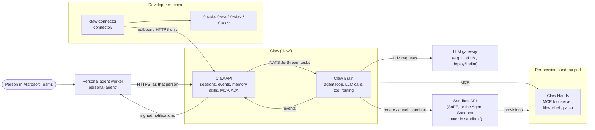

# PrimusClaw

[](https://github.com/AMD-AGI/PrimusClaw/actions/workflows/tests.yml)
[](https://github.com/AMD-AGI/PrimusClaw/actions/workflows/build.yaml)
[](https://github.com/AMD-AGI/PrimusClaw/actions/workflows/personal-agent-packaging.yml)
[](https://github.com/AMD-AGI/PrimusClaw/actions/workflows/connector-packaging.yml)
[](https://github.com/AMD-AGI/PrimusClaw/actions/workflows/codeql.yml)
<br>
[](https://www.npmjs.com/package/@primusclaw/personal-agent)
[](https://www.npmjs.com/package/@primusclaw/connector)
[](https://hub.docker.com/r/primussafe/personal-agent-teams)
[](LICENSE)

PrimusClaw is an open platform for running LLM agents on infrastructure you
control, and for reaching them from the chat you already use. **Claw** is the
agent orchestration platform: an API / Brain / Hands service triad that runs
autonomous agent sessions inside per-session sandboxes. The **personal agent**
is a chat assistant built on Claw: each person gets a standing assistant that
works with their own Claw identity, with Microsoft Teams as its first channel.
The **connector** is a small client for a developer's own machine that lets
Claw, and the assistant through it, drive the Claude Code, Codex or Cursor
sessions on that machine, using outbound HTTPS only.

> **Status: pre-1.0.** Every released version is 0.x. Interfaces, configuration
> and wire formats may change between minor releases; pin what you deploy and
> read the changelogs before upgrading.

## What's in this repository

| Component | What it is | Path | How it ships | Docs |
|---|---|---|---|---|
| **Claw** | Agent orchestration platform: API, Brain (agent loop) and Hands (in-sandbox tool server), in TypeScript | [`claw/`](claw) | Container image `docker.io/primussafe/claw` (one image, three roles), Helm chart in [`claw/deploy/charts/claw`](claw/deploy/charts/claw) | [`claw/README.md`](claw/README.md) |
| **Personal agent** | Personal chat assistant on Claw: channel-neutral core, Node runtime, Microsoft Teams channel | [`personal-agent/`](personal-agent) | npm: [`@primusclaw/personal-agent`](https://www.npmjs.com/package/@primusclaw/personal-agent), [`-runtime`](https://www.npmjs.com/package/@primusclaw/personal-agent-runtime), [`-teams`](https://www.npmjs.com/package/@primusclaw/personal-agent-teams); image `docker.io/primussafe/personal-agent-teams` | [`personal-agent/README.md`](personal-agent/README.md) |
| **Connector** | `claw-connector` CLI: connects the coding agents on a developer machine to Claw | [`connector/`](connector) | npm: [`@primusclaw/connector`](https://www.npmjs.com/package/@primusclaw/connector) | [`connector/README.md`](connector/README.md) |
| **Agent Sandbox** | Kubernetes control plane for the per-session sandbox pods; a fork of `kubernetes-sigs/agent-sandbox`, in Go, Apache-2.0 | [`sandbox/`](sandbox) | Container images `docker.io/primussafe/agent-sandbox-controlplane` and `agent-sandbox-envd-injector`, Helm chart in [`sandbox/deploy/helm`](sandbox/deploy/helm) | [`sandbox/README.md`](sandbox/README.md) |
| **Stack installer** | Installs Agent Sandbox, Claw and an optional LiteLLM gateway in one command | [`deploy/`](deploy) | Scripts and Helm chart in this repository | [`deploy/README.md`](deploy/README.md) |

## Architecture



- **Claw** keeps its state in PostgreSQL, its task queue and event bus in NATS
  JetStream, and session workspaces in S3-compatible object storage. One
  container image serves all three roles, chosen by the entrypoint's first
  argument (`api`, `brain` or `hands`). See
  [`claw/README.md`](claw/README.md#architecture) and the design notes in
  [`claw/docs/`](claw/docs/README.md).
- **The personal agent** holds no model or sandbox of its own: it is a client
  of the Claw API, and each person acts with their own Claw identity. With
  proactive messages switched on, Claw sends it each person's notifications
  (assistant replies, approvals, finished runs, remote-agent events). See
  [`personal-agent/README.md`](personal-agent/README.md#architecture).
- **The connector** opens no port and needs no public address. Claw relays the
  conversation and keeps an audit trail; the agent, the files, the checkout and
  the model credentials stay on the developer's machine, and `agents.toml` on
  that machine decides what each agent may touch. See
  [`connector/README.md`](connector/README.md) and
  [`claw/docs/remote-agents.md`](claw/docs/remote-agents.md).

## Prerequisites

Claw delegates authentication and sandbox workload placement to **SaFE**
(AMD's Secure Agent Fabric/Environment platform, published separately as
[AMD-AGI/Primus-SaFE](https://github.com/AMD-AGI/Primus-SaFE)). `SAFE_API_URL`
is **required for any production deployment**, and the API fails closed
without it.

You do not need SaFE to evaluate the project:

| What you want to do | What you need |
|---|---|
| Exercise the tool-execution layer end to end | Node 26. Run `make demo`: no cluster, GPU, LLM key, or network egress |
| Run api / brain / hands locally | Node 26, PostgreSQL, NATS, S3-compatible storage, an LLM gateway |
| Run the personal agent | Node 26 (or Docker), a Claw API and its SaFE endpoint; to answer real people, also a Teams bot registration and an Azure Service Bus namespace (see [its README](personal-agent/README.md#running-the-worker)) |
| Connect a developer machine | Node.js 22 or newer, a working Claude Code, Codex or Cursor CLI, and the address of a Claw API |
| Install the full stack on a cluster | Kubernetes, `kubectl`, `helm`, a storage class, and a SaFE endpoint |
| Install on an **isolated** cluster with no SaFE | `deploy/deploy.sh --insecure-sandbox`, which turns sandbox authentication **off entirely**: never on a shared or reachable cluster |

Claw and the personal agent require **Node 26** (pinned in
[`claw/.nvmrc`](claw/.nvmrc)); the connector runs on Node.js 22 or newer.

## Quick start

### Evaluate locally, without a cluster

```bash
git clone https://github.com/AMD-AGI/PrimusClaw.git
cd PrimusClaw
(cd claw && npm ci && npm run build)
make demo
```

`make demo` runs the Hands MCP server (the layer that edits files and runs
commands for an agent) against a throwaway workspace and drives it over the
real MCP transport. See [`claw/examples/hands-mcp`](claw/examples/hands-mcp/README.md).
To run the API, Brain and Hands against your own PostgreSQL, NATS, object
storage and LLM gateway, follow [`claw/README.md`](claw/README.md#build-and-run).

### Run the personal agent

The worker reads its whole configuration from the environment.
[`personal-agent/examples/worker.env.example`](personal-agent/examples/worker.env.example)
lists every setting and
[`personal-agent/docs/configuration.md`](personal-agent/docs/configuration.md)
describes each one. Keep the filled-in file outside any repository.

From the published image (runs as uid 65534; the state volume must be writable
by it):

```bash
docker run --env-file /path/outside/the/repo/worker.env \
  -v personal-agent-data:/data \
  docker.io/primussafe/personal-agent-teams:0.1.1
```

From npm (Node 26):

```bash
npm install @primusclaw/personal-agent-teams
node --env-file=/path/outside/the/repo/worker.env \
  node_modules/@primusclaw/personal-agent-teams/dist/main.js
```

A deployment that adds its own integrations builds the worker in code with
`buildWorker(env, plugins, options)` from `@primusclaw/personal-agent-teams`.
See [Running the worker](personal-agent/README.md#running-the-worker).

### Connect a developer machine

```bash
npm install -g @primusclaw/connector
claw-connector init       # writes agents.toml; then set `roots`, the directories an agent may work in
claw-connector login --server https://claw.example.com/claw-api --identity-url https://identity.example.com
claw-connector service install
claw-connector doctor
```

The two URLs are placeholders for the addresses of your Claw deployment.
Shorter still: ask a chat client built on Claw to connect your dev environment.
It answers with one command (`npm install -g @primusclaw/connector@latest &&
claw-connector pair <code> --server <url>`) that installs the connector, pairs
the machine, writes `agents.toml` for the agents it finds and starts the
service. See the [connector quick start](connector/README.md#quick-start-about-5-minutes).

### Deploy the full stack

```bash
# Preview: prints the plan; child installers preview where they support it.
SAFE_API_URL=https://safe.example.com bash deploy/deploy.sh --dry-run

# Install Agent Sandbox, Claw and LiteLLM (--skip-litellm to omit the gateway).
SAFE_API_URL=https://safe.example.com bash deploy/deploy.sh --yes
```

Read [`deploy/README.md`](deploy/README.md) for profiles, credentials and the
LiteLLM wrapper, [`claw/deploy/README.md`](claw/deploy/README.md) to install or
upgrade Claw alone, and the production posture in [`SECURITY.md`](SECURITY.md)
before exposing a deployment. `--insecure-sandbox` exists for isolated
development clusters only: it deploys the sandbox control plane with no
authentication at all.

## Releases and versioning

The personal agent and the connector are released on tags of their own and
versioned independently; the Claw and Agent Sandbox images are built from `main`
and from `v*` tags:

| Component | Tag | Published to | Release notes |
|---|---|---|---|
| Personal agent (three packages and the image, one version) | `personal-agent-vX.Y.Z` | npm; the image to the configured registry (Docker Hub by default) while image publishing is switched on | [`personal-agent/CHANGELOG.md`](personal-agent/CHANGELOG.md) |
| Connector | `connector-vX.Y.Z` | npm | the [GitHub Release](https://github.com/AMD-AGI/PrimusClaw/releases) of the tag |
| Claw, Agent Sandbox | images built from `main` (`latest` plus a timestamp tag) and from `v*` tags | Docker Hub | [`CHANGELOG.md`](CHANGELOG.md) |

After each package's first version, which a maintainer published by hand so
that it could be given a Trusted Publisher, npm releases are published from
GitHub Actions with [Trusted Publishing](https://docs.npmjs.com/trusted-publishers)
(OIDC, no stored npm token) and npm provenance. Each such release carries a
build provenance attestation you can check with
`gh attestation verify <file> --repo AMD-AGI/PrimusClaw`, and its publish job
waits for a required reviewer's approval. The release procedures are in the
connector's and the personal agent's READMEs.

## Documentation

- [`claw/README.md`](claw/README.md): building, running and testing Claw;
  architecture, reserved workspace paths, key environment variables.
- [`claw/docs/`](claw/docs/README.md): Claw design notes (sessions, A2A,
  plugins, remote agents, identity, GitHub review, ...).
- [`claw/deploy/README.md`](claw/deploy/README.md): Docker and Kubernetes
  deployment of Claw.
- [`personal-agent/README.md`](personal-agent/README.md) and its
  [configuration reference](personal-agent/docs/configuration.md).
- [`connector/README.md`](connector/README.md): install, `agents.toml`, what
  the connector enforces, keeping it running.
- [`sandbox/README.md`](sandbox/README.md): the Agent Sandbox control plane and
  its security model.
- [`deploy/README.md`](deploy/README.md): the whole-stack installer.
- [`docs/`](docs/index.md): the Sphinx site for the Python packages.

## Contributing

Contributions are welcome. [`CONTRIBUTING.md`](CONTRIBUTING.md) covers setup,
the checks a pull request must pass, coverage floors, and the
[Developer Certificate of Origin](https://developercertificate.org/) sign-off
(`git commit -s`) required on every commit. `make verify` from the repository
root builds and tests Claw and Agent Sandbox, runs the LiteLLM wrapper's Python
tests, builds the docs, and runs the lint and license checks; `make help` lists
the per-tree targets. The personal agent (`npm run check` in `personal-agent/`) and the connector (see
its [Development](connector/README.md#development) section) have their own
checks, which CI runs in their own workflows.

## Security

Please do **not** report vulnerabilities in public issues. Use GitHub's
[private vulnerability reporting](https://github.com/AMD-AGI/PrimusClaw/security)
or the AMD Product Security portal, as described in [`SECURITY.md`](SECURITY.md).
That file also states the security posture a production deployment is
expected to meet; read it before you deploy.

## Code of Conduct

Participation in this project is governed by the
[Code of Conduct](CODE_OF_CONDUCT.md).

## License

PrimusClaw is released under the [MIT License](LICENSE), with one exception:
[`sandbox/`](sandbox) is a fork of
[kubernetes-sigs/agent-sandbox](https://github.com/kubernetes-sigs/agent-sandbox)
(© The Kubernetes Authors, with AMD additions) and is licensed under the
**Apache License 2.0**; see [`sandbox/LICENSE`](sandbox/LICENSE),
[`sandbox/NOTICE`](sandbox/NOTICE) and [`sandbox/UPSTREAM.md`](sandbox/UPSTREAM.md).
[`REUSE.toml`](REUSE.toml) records the license of every path.

Third-party agent CLIs that PrimusClaw starts (Claude Code, OpenAI Codex,
`cursor-agent`) are installed at run time, not distributed with this
repository, and are governed by their own license terms; see "Third-Party
Tools and Agents" in [`LICENSE`](LICENSE).
