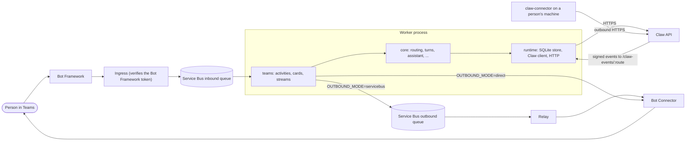

<!--
Copyright Advanced Micro Devices, Inc.
SPDX-License-Identifier: MIT
-->

# Personal agent

A personal chat assistant that works through [Claw](../claw/README.md). People talk to it in their chat client; it
answers in Claw sessions run with their own Claw identity, keeps a standing assistant for each person, posts Claw's
notifications back into the chat, drives the coding agents on a person's own machine (through
[claw-connector](../connector/README.md)), and can review pull requests on a colleague's behalf. The agent's display
name defaults to "Clawy".

The entry point today is **Microsoft Teams**. The domain logic is channel-neutral, so another channel is a new adapter
package rather than a rewrite.

> **Status.** The TypeScript worker is being assembled. The packages below are on `main`; the process entry
> (`packages/teams/src/main.ts`) and its assembly (`packages/teams/src/assembly/**`) arrive with pull request
> [#615](https://github.com/AMD-AGI/PrimusClaw/pull/615). Until then the packages are libraries with their tests, and
> there is no runnable worker on `main`.

## Packages

`personal-agent/` is its own npm workspace (own `package-lock.json`, Node 26), next to `claw/` and `connector/`.

| Package                              | Path               | What it holds                                                                                                                                                                                                                                                                      |
| ------------------------------------ | ------------------ | ---------------------------------------------------------------------------------------------------------------------------------------------------------------------------------------------------------------------------------------------------------------------------------- |
| `@primusclaw/personal-agent`         | `packages/core`    | The channel-neutral domain: routing and commands, turns, the assistant, proactive messages, remote-agent and review state machines, feedback, limits, redaction, view models (no card JSON), locales, and every **port** (`src/ports/`) and **plugin** interface (`src/plugins/`). |
| `@primusclaw/personal-agent-runtime` | `packages/runtime` | Node adapters of core's ports: SQLite repositories (`node:sqlite`), Fernet (`node:crypto`), the Claw HTTP client, the token exchange, Prometheus metrics, settings and secrets from the environment, the HTTP server and its generic routes, the system clock and randomness.      |
| `@primusclaw/personal-agent-teams`   | `packages/teams`   | The Teams channel: activity parsing, Adaptive Cards rendered from core's views, rich text, streams, the Bot Connector, the Service Bus queues, Azure Key Vault and workload identity, and the process assembly.                                                                    |
| (shared fakes, not a package)        | `test-support/`    | Fakes for tests: clock, randomness, surface, store, HTTP server, card catalog and snapshots.                                                                                                                                                                                       |

### Layering

The layers are enforced in CI by [dependency-cruiser](.dependency-cruiser.cjs) (`npm run depcruise`); every rule is an
error:

- **core is channel-neutral.** It imports only itself, `zod` and the Claw wire contract. No runtime, no channel, no
  Azure, Bot Framework, fastify, `node:sqlite`, `node:crypto`, `prom-client` or any other Node built-in: a port or a
  plugin brings those in.
- **The Claw wire contract enters through one file.** `packages/core/src/protocol.ts` is the only file that imports
  `claw/packages/protocol/src`; the contract is compiled in, so a field Claw renames fails this workspace's typecheck.
- **runtime depends on core only**; **teams depends on core and runtime**.
- **Packages meet through their entry** (`src/index.ts`), never by a deep path.
- **A domain never imports its view** (`src/<area>/` must not import `src/<area>-view/`).
- **No cycles**, type-only imports included; production code never imports `test-support/`, a test or a development
  dependency; every import resolves and is declared.

A deployment's own integrations (an identity platform, a model gateway's rules, extra HTTP routes, an issue tracker for
feedback) are **plugins**: objects implementing core's plugin interfaces (`IdentityLookup`, `KeyRevoker`,
`FeedbackSink`, `ModelRefusalPolicy`, `TokenExchange`, `RouteExtension`, integrations), handed to the assembly. The
public build runs with the neutral defaults (`neutralPlugins()`); nothing is loaded dynamically.

## Architecture



- **Inbound.** Teams activities reach the worker through a Service Bus queue with one session per conversation, so a
  conversation's messages are handled in order and one poison message never blocks it. The ingress in front of the
  queue verifies the Bot Framework token; it is a separate component and not part of this workspace yet.
- **Outbound.** By default the worker hands replies to the outbound queue for a relay to post. With
  `OUTBOUND_MODE=direct` it posts to the Bot Connector itself, which is what Teams' streaming and message deletion need;
  the queue stays as the fallback. The bot's token is only ever sent to Bot Connector hosts on an allow-list
  (`packages/teams/src/connector/hosts.ts`).
- **State.** One SQLite database (`TEAMS_DB_PATH`): links between chat identities and Claw, sessions, conversation
  references, subscriptions, pending approvals, feedback. Credentials in it are encrypted with Fernet keys
  (`TEAMS_ENCRYPTION_KEYS`).
- **HTTP.** `/healthz`; `/primus-claw-agent/link`, where the console exchanges a new Claw API key for a one-time code the
  person types as `/link CODE`; `/claw-events/<route>` for Claw's signed notifications when proactive messages are on;
  the routes a deployment's plugins add. `/metrics` (Prometheus) listens on a port of its own (`METRICS_PORT`).

### Claw and claw-connector

The worker is a client of the Claw API (`CLAW_API_URL`) and holds no model or sandbox of its own. Each person acts with
their own Claw identity: either an API key they link from the console (`/link`), or, with `TEAMS_EXCHANGE_ENABLED`, a
token exchanged for them with the identity service (see [claw/docs/identity-client.md](../claw/docs/identity-client.md)).
Claw sends the worker notifications for each person's subscription (assistant replies, approvals, finished runs,
remote-agent events), signed with that person's secret.

Remote agents are coding agents (Claude Code, Codex, Cursor) on a person's own machine. The machine runs
[claw-connector](../connector/README.md), which only makes outbound requests to Claw; the worker talks to Claw's
remote-agent API ([claw/docs/remote-agents.md](../claw/docs/remote-agents.md)) and never to the machine. Review for a
colleague follows [claw/docs/github-review.md](../claw/docs/github-review.md).

## Development

Requires Node 26 (`claw/.nvmrc`). From `personal-agent/`:

```bash
npm ci
npm run check   # every gate CI runs, in order
npm test        # the test suite alone
```

`npm run check` runs, and CI runs the same steps:

| Step                   | What it holds the code to                                                                                                                                                                         |
| ---------------------- | ------------------------------------------------------------------------------------------------------------------------------------------------------------------------------------------------- |
| `npm run typecheck`    | `tsc` over every package, test and fake: `strict`, `noUncheckedIndexedAccess`, `exactOptionalPropertyTypes`.                                                                                      |
| `npm run lint`         | ESLint with typescript-eslint strict (type-checked): no import cycles, complexity ≤ 15, functions ≤ 80 lines, files ≤ 600 lines, no `any`, no floating promises, no unexplained `eslint-disable`. |
| `npm run format:check` | Prettier.                                                                                                                                                                                         |
| `npm run depcruise`    | The layering rules above.                                                                                                                                                                         |
| `npm run coverage`     | The whole suite once under c8, each package against its floor on lines, statements, functions and branches: core 90 %, runtime 85 %, teams 85 % (`scripts/coverage.ts`).                          |
| `npm run ported-tests` | The ported-tests ledgers against the tests that actually ran in that coverage run.                                                                                                                |

Tests use `node:test` with `tsx`: `node --import tsx --test packages/core/test/<file>.test.ts` runs one file.

### Building the packages

The three packages are published to npm in lockstep (one version for all three, naming each other by it exactly).
Inside the workspace nothing is built: `tsconfig.json`'s `paths` point each package name at its `src/`, so typecheck,
lint, the layers and the tests all read the sources. What npm gets is built from them:

```bash
npm run build        # scripts/build.ts: packages/*/dist (esbuild bundles, tsc declarations, the licence)
npm run check-pack   # scripts/check-pack.ts: pack, inspect, install in an empty directory, import, type-check
```

Each package is one ES module bundle, its dependencies (and the other two packages) left to npm. Core's bundle and
declarations carry the Claw wire contract from `claw/packages/protocol`, which is not published on its own. A file a
module reads at run time (the store's `schema.sql`) ships next to the bundle. `check-pack` fails on a file in a tarball
that should not be there (sources, tests, fixtures) or one missing from it, on a manifest that cannot be published, and
on packages that do not install, import, run the worker program or compile against their declarations in a clean
directory. CI runs both on every change (`.github/workflows/personal-agent-packaging.yml`).

### The ported-tests ledgers

The worker is a port of an earlier Python implementation, and its behaviour is the specification. Each file in
`ported-tests/` records, for one line of work, where every Python test went:

```text
python-baseline: <the commit of the Python implementation the port follows>
<python test id> -> <ts test file>::<test name>          ported
<python test id> -> MERGED <ts test file>::<test name>   folded into a TS test that covers it with others
<python test id> -> INTERNAL                             tests only a deployment's own plugin or artefact
<python test id> -> DROPPED: <reason>                    no longer applies, and why
```

`npm run ported-tests` fails when a named TS test did not run and pass (a skipped, todo or missing test fails too), when
a line is malformed, or when a Python test is listed twice. So a test a ledger names can be renamed or deleted only
together with its ledger line.

## Running the worker

> Needs [#615](https://github.com/AMD-AGI/PrimusClaw/pull/615): `packages/teams/src/main.ts` is not on `main` yet.

```bash
cd personal-agent
npm ci
cp examples/worker.env.example /path/outside/the/repo/worker.env   # fill it in
node --env-file=/path/outside/the/repo/worker.env --import tsx packages/teams/src/main.ts
```

As an image (`personal-agent/Dockerfile`, built from the repository root: it builds and checks the three packages
as a release would, installs them from their tarballs, and runs `dist/main.js` as uid 65534):

```bash
docker build -f personal-agent/Dockerfile -t personal-agent-teams .
docker run --env-file /path/outside/the/repo/worker.env -v personal-agent-data:/data personal-agent-teams
```

The store defaults to `/data/state.db`; the volume must be writable by uid 65534. The base image is pinned by digest
(the one `claw/Dockerfile` runs on). CI builds and smoke-tests the image on every change that
touches it and never pushes it. `/metrics` names the running build as
`personal_agent_build_info{version="<the teams package version>",node="<Node.js version>"} 1`.

A deployment's own entry builds the worker with `buildWorker(env, plugins, options)`; its MCP servers and `/whoami`
lines go in through `options.registerIntegrations(registry)`, on top of the plugins' own (`main(env, plugins)` takes no
options).

The worker reads its whole configuration from the environment once, at start. A setting it cannot use (a required one
missing, a malformed number, an unknown word in a strict switch) stops it before it takes a message, with one line on
stderr saying why: a secret the secret source (`SECRETS_SOURCE`) cannot load exits with status 2, anything else that
stops the start (a key file that cannot be read included) with status 1. Some feature switches are lenient and read a typo as off (or, for `REMOTE_PUSH_ENABLED`, as on); the configuration
reference says which.
`SIGTERM` or `SIGINT` stops taking new work, finishes what is in hand and exits.

To answer real people it needs, besides Claw: a Teams bot registration and app package, the ingress in front of the
inbound queue, a Service Bus namespace with the two queues (sessions enabled on the inbound one), and, for the default
outbound mode, a relay that posts the outbound queue to the Bot Connector.

## Configuration

[`examples/worker.env.example`](examples/worker.env.example) lists every setting the worker reads, with placeholder
values (all but the release gate's test entry); [`docs/configuration.md`](docs/configuration.md) describes each one and marks the ones that arrive with #615.
In short:

- **Required:** `CLAW_API_URL`, `SAFE_API_URL`, `PUBLIC_BASE_URL`, `TEAMS_ENCRYPTION_KEYS`, and either
  `SERVICEBUS_NAMESPACE` (with the worker identity) or the two `SERVICEBUS_*_CONNECTION_STRING`s. Direct outbound mode
  adds the bot's identity (`BOT_*`).
- **Secrets** (`TEAMS_ENCRYPTION_KEYS`, `TEAMS_EXCHANGE_CLIENT_SECRET`, and a deployment's GitHub App key) come from the
  environment by default, or from Azure Key Vault with `SECRETS_SOURCE=keyvault`. Put them in a secret store, never in
  a file in a repository.
- **Features** are off until switched on: notifications from Claw (`PROACTIVE_ENABLED`), the assistant
  (`ASSISTANT_ENABLED`), remote agents (`REMOTE_AGENTS_ENABLED`), the token exchange (`TEAMS_EXCHANGE_ENABLED`), review
  for a colleague (`TEAMS_GITHUB_REVIEW_ENABLED`) and more.

## Security

Report vulnerabilities through the private process in the repository's [SECURITY.md](../SECURITY.md), never in a public
issue. That file also states the posture a production deployment of PrimusClaw is expected to meet.
