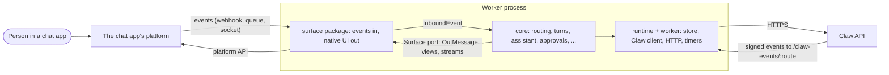

<!--
Copyright Advanced Micro Devices, Inc.
SPDX-License-Identifier: MIT
-->

# Adding a surface

A **surface** is a chat app the personal agent talks to people through. Microsoft Teams is the first one. This guide is
for whoever adds the next (Slack, a web chat, a messenger): what to build, which interfaces to implement, what the
worker and Claw expect of it, and how to prove it works. Every interface below is linked to its source, which is the
authority; the guide explains how the parts fit.

Two pieces of code back the guide and run in CI, so the contract it describes is exercised on every change (the prose
itself is checked by review, not by a test):

- **The echo surface** ([`test-support/echo-surface/`](../test-support/echo-surface)): a complete, minimal surface for
  a made-up chat app, about 600 lines. The [walkthrough](#walkthrough-the-echo-surface) below follows it.
- **The conformance kit** ([`test-support/surface-conformance/`](../test-support/surface-conformance)): the tests every
  surface package must pass, on its own worker, against a fake Claw. The Teams package and the echo surface both run it
  ([`packages/teams/test/conformance/`](../packages/teams/test/conformance),
  [`test-support/surface-conformance/echo.test.ts`](../test-support/surface-conformance/echo.test.ts)).

Contents:

1. [Architecture](#architecture)
2. [The SurfaceAdapter contract](#the-surfaceadapter-contract)
3. [The Surface port and SurfaceCaps](#the-surface-port-and-surfacecaps)
4. [Inbound: the platform's events as core's](#inbound-the-platforms-events-as-cores)
5. [Outbound: core's messages and views as native UI](#outbound-cores-messages-and-views-as-native-ui)
6. [Identity](#identity)
7. [Claw interactions](#claw-interactions)
8. [Configuration](#configuration)
9. [Packaging and release](#packaging-and-release)
10. [Walkthrough: the echo surface](#walkthrough-the-echo-surface)
11. [Checklist and acceptance](#checklist-and-acceptance)

## Architecture



The personal agent is one npm workspace with three kinds of package
([layering](../README.md#layering), enforced by `npm run depcruise`):

| Layer                | Package                                                                                                   | What it owns                                                                                                                                                                                                                                                          |
| -------------------- | --------------------------------------------------------------------------------------------------------- | --------------------------------------------------------------------------------------------------------------------------------------------------------------------------------------------------------------------------------------------------------------------- |
| **core**             | `@primusclaw/personal-agent` ([`packages/core`](../packages/core))                                        | Everything the agent decides and says, channel-neutral: routing and commands, chat turns, the assistant, approvals, proactive messages, remote agents, review, view **models** (never card JSON), locales, and the **ports** a surface implements (`src/ports/`).     |
| **runtime + worker** | `@primusclaw/personal-agent-runtime` and its `/worker` entry ([`packages/runtime`](../packages/runtime))  | Node adapters of core's ports (SQLite store, Claw HTTP client, token exchange, metrics, HTTP server), and the **worker process** on any surface: settings, store, Claw client, the features behind the router, HTTP endpoints, `/metrics`, timers (`assembleWorker`). |
| **surface**          | one package per chat app, e.g. `@primusclaw/personal-agent-teams` ([`packages/teams`](../packages/teams)) | The platform's wire: reading its events into core's `InboundEvent`s, drawing core's messages and views as its native UI, posting through its API, its own settings and secrets, where its events come from.                                                           |

The rules that matter to a surface: it depends on core, runtime and runtime's worker only; it **never imports another
surface package** (a Slack package must not need Teams); it uses other packages through their entries; core never
imports a surface. Helpers of one surface are named after it (`teams-ingress` is Teams').

**Claw** is the backend: the worker is a client of the Claw API (`CLAW_API_URL`) and holds no model of its own. Each
person acts with their own Claw identity. Claw talks back through **notification subscriptions**: signed HTTP posts to
the worker's `/claw-events/<route>`, one subscription per person and surface, carrying the assistant's replies,
approvals, finished runs and remote-agent events.

## The SurfaceAdapter contract

A surface package implements one interface,
[`SurfaceAdapter`](../packages/runtime/src/worker/surface-adapter.ts), and hands it to
[`assembleWorker`](../packages/runtime/src/worker/assemble.ts). The worker calls its stages **in this order, once each**;
any stage may throw to stop the start (one `CRITICAL` line on stderr; `SecretsUnavailable` exits with status 2, anything
else with 1, see [`runMain`](../packages/runtime/src/worker/run-main.ts)).

```ts
export interface SurfaceAdapter {
  readonly name: string; // the worker logs as `<name>_agent`
  prepare(env: WorkerEnv): PreparedSurface;
}

export interface PreparedSurface {
  loadSecrets?(names: readonly SecretName[], deps: SurfaceDeps): Promise<ReadonlyMap<SecretName, string>>;
  configure(settings: Settings): ConfiguredSurface;
}

export interface ConfiguredSurface {
  readonly host: string; // where the worker's HTTP endpoints listen
  readonly shape: SurfaceShape; // what the features read of the surface besides its port
  open(context: SurfaceDeps & { readonly random: Random }): OpenedSurface;
}

export interface OpenedSurface {
  readonly surface: Surface; // core's port
  typedEvent(conversation: ConversationRef, messageId: MessageId, text: string): InboundEvent | undefined;
  connect(context: ConnectContext): ConnectedSurface;
  readonly closes: readonly (() => unknown)[];
}

export interface ConnectedSurface {
  readonly routes: readonly HttpRoute[]; // served on the worker's own server after its own routes
  readonly source: InboundSource | undefined; // a consumer the worker runs until it stops
}
```

Step by step:

1. **`prepare(env)`**: before anything else is read. Refuse here what the surface cannot run with at all (Teams reads
   its release-gate test entry first, so a typo in it never picks a path silently).
2. **`loadSecrets(names, deps)`** (optional): the secrets named in `names`, which are what core's settings need
   (`PA_ENCRYPTION_KEYS` always; `PA_EXCHANGE_CLIENT_SECRET` with the exchange; `FEEDBACK_GITHUB_APP_KEY` with the
   feedback plugin's GitHub App). Without it the worker reads them from the environment, and `SECRETS_SOURCE` must be
   unset or `env` ([`envSecrets`](../packages/runtime/src/worker/assemble.ts)). Teams reads Azure Key Vault here.
3. **`configure(settings)`**: after core's settings, before the store opens. Read and check the surface's own settings
   (its tokens, its endpoints, its reply style) and return:
   - `host`: `"0.0.0.0"` in production, the loopback for a test entry;
   - `shape`: a [`SurfaceShape`](../packages/runtime/src/worker/features-base.ts):

     | Field                | What it is                                                                                                                                                                                                                                                                                                                                                                                            |
     | -------------------- | ----------------------------------------------------------------------------------------------------------------------------------------------------------------------------------------------------------------------------------------------------------------------------------------------------------------------------------------------------------------------------------------------------- |
     | `style: ReplyStyle`  | The surface's reply style: whether a turn streams its text (`streamText`), shows the assistant's receipt, progress and streamed words, the worker's own thumbs on phones, suggested replies, citations, and `streamsIn(kind)` per kind of chat. These are the surface's **settings**, not its caps: core asks for a stream where the style says so, and a surface that cannot stream refuses (below). |
     | `installHintUrl`     | Where someone who has not added the bot can add it ("" for none).                                                                                                                                                                                                                                                                                                                                     |
     | `restoreRef(stored)` | A stored conversation reference back as core's `ConversationRef`; `undefined` when it names none. Never throws.                                                                                                                                                                                                                                                                                       |
     | `refOf(stored)`      | The same, but always a reference (one that names no conversation fails at send).                                                                                                                                                                                                                                                                                                                      |
     | `followWire(asked)`  | The fields a followed review keeps to reopen the reviewer's chat after a restart (Teams: service URL, tenant, bot id); `{}` when none are needed.                                                                                                                                                                                                                                                     |
     | `surfaceId`          | The surface's id on the Claw wire: sent as the notification subscription's `surface`. **Must equal `SurfaceCaps.channel`** (the conformance kit checks it).                                                                                                                                                                                                                                           |
     | `channelName`        | Its name as people know it ("Teams").                                                                                                                                                                                                                                                                                                                                                                 |
     | `version`            | The surface package's version: what `/metrics` and a feedback report name.                                                                                                                                                                                                                                                                                                                            |

4. **`open(deps)`**: once the store and the Claw client exist. Build the outbound side (the platform API client) and
   return:
   - `surface`: the [`Surface`](../packages/core/src/ports/surface.ts) port, [below](#the-surface-port-and-surfacecaps);
   - `typedEvent(conversation, messageId, text)`: `text` read as if the person had typed it as message `messageId` in a
     stored conversation, sender included (what a deployment's on-behalf route hands the router through
     `WorkerServices.handleAsTyped`; the worker refuses an event whose sender is not the person named). `undefined` when
     the stored reference cannot say who the person is;
   - `closes`: what to close when the worker stops, after the features and before the store, each even when one before
     it failed.
5. **`connect(context)`**: once the features are built. The surface's inbound side, handing every event to
   `context.route(event)`:
   - `routes`: HTTP routes on the worker's server (a webhook such as Slack's Events API; the echo surface's
     `POST /echo/v1/events`), and/or
   - `source`: an [`InboundSource`](../packages/runtime/src/worker/runner.ts) the worker runs and stops (Teams: the
     Service Bus consumer; a socket-mode client).

   [`ConnectContext`](../packages/runtime/src/worker/surface-adapter.ts) also gives the store, the token exchange, the
   group context (a group message deleted or edited on the platform changes what is kept of it), metrics, the clock and
   the logger.

The package then exports its `buildWorker` and `main`, which are the worker's with its adapter:

```ts
export const buildWorker: BuildWorker = (env, plugins, options = {}) =>
  assembleWorker(mySurface(), env, plugins, options);

export async function main(env: WorkerEnv, plugins: Plugins | PluginFactory = neutralPlugins()): Promise<number> {
  return await runMain(() => buildWorker(env, plugins));
}
```

Teams' are in [`packages/teams/src/assembly/worker.ts`](../packages/teams/src/assembly/worker.ts) and
[`packages/teams/src/main.ts`](../packages/teams/src/main.ts).

## The Surface port and SurfaceCaps

[`packages/core/src/ports/surface.ts`](../packages/core/src/ports/surface.ts) is the whole of what core sees of a chat
app:

- **`Surface`**: `caps`, `conversation(ref)` (one conversation's outbound side), `fetchFile(file)` (the bytes of a file
  that came with a message, or `file_refused`), `openPersonal(via, user)` (the bot's 1:1 chat with someone, or
  `undefined` when the platform will not open it), `members(conversation)` (a roster, or `undefined`).
- **`Conversation`**: `typing`, `send` (post, no id wanted), `post` (post and return the new message's id, or
  `undefined` when the platform did not say it), `update(id, message)`, `delete(id)`, `outgoing(message)` (the
  envelope `send` would publish, built without sending), `deliver(envelope)` (publish a stored envelope, possibly in
  another process), `openStream(replyTo, status)`, plus `replyTo` (the message this reference was read from), `edited`
  (the messages this conversation tried to replace) and `markSettled(id)` (count a card message as settled without editing
  it, when it is about to be deleted).
- **`LiveStream`**: `inform(status)`, `emit(text)` (the whole text so far; it only grows), `finish(message)`.

**`SurfaceCaps`** says what the surface can do. Core reads the identity and the limits itself; the booleans describe the
surface, and **the surface enforces them at the port**: a call it cannot honour is refused the way the port says, and
core's caller then shows the same thing another way. Core does not test the booleans before calling.

| Cap              | Meaning                                                                                                                                                                                                        | Teams (direct mode)   | When the surface cannot                                                                                                                                                                                   |
| ---------------- | -------------------------------------------------------------------------------------------------------------------------------------------------------------------------------------------------------------- | --------------------- | --------------------------------------------------------------------------------------------------------------------------------------------------------------------------------------------------------- |
| `channel`        | The surface's id: `channel_context.channel` to Claw, and the prefix of what is stored per surface (votes, uploads, group scopes). Lower case letters, digits, `-`; start with a letter (Claw's surface label). | `teams`               | (required)                                                                                                                                                                                                |
| `name`           | Full name, as a person reads it.                                                                                                                                                                               | `Microsoft Teams`     | (required)                                                                                                                                                                                                |
| `shortName`      | Short name, in core's sentences (the console key it names, "PrimusClaw Teams").                                                                                                                                | `Teams`               | (required)                                                                                                                                                                                                |
| `citationsMax`   | Citations shown on one message.                                                                                                                                                                                | 20                    | Core keeps at most this many.                                                                                                                                                                             |
| `suggestionsMax` | Suggested replies under one message.                                                                                                                                                                           | 3                     | Core keeps at most this many.                                                                                                                                                                             |
| `streamSeconds`  | How long after its first request the platform closes a live message itself.                                                                                                                                    | 600                   | Core closes a stream with its final before then.                                                                                                                                                          |
| `streaming`      | A live, growing message (`openStream`).                                                                                                                                                                        | `true` (queue: false) | `openStream` returns `stream_refused`; core shows progress with `typing` and posts the answer as a message.                                                                                               |
| `messageIds`     | `post` returns the new message's id.                                                                                                                                                                           | `true`                | `post` and `deliver` return `undefined`; core keeps sending instead of editing what it cannot name.                                                                                                       |
| `edit`           | A posted message can be replaced.                                                                                                                                                                              | `true`                | Core still calls `update`; the surface shows the new content as a new message (the echo surface does) or leaves the message as it was, and never edits.                                                   |
| `delete`         | A posted message can be removed.                                                                                                                                                                               | `true` (queue: false) | `delete` returns `delete_unsupported`; the message stays.                                                                                                                                                 |
| `views`          | Core's views are drawn natively.                                                                                                                                                                               | `true`                | A view is sent as its `fallbackText`. **Many views carry no fallback text** (choice cards, approvals, boards), so without views the interactive features are lost: in practice a surface must draw views. |
| `citations`      | Citations are shown.                                                                                                                                                                                           | `true`                | The surface drops them.                                                                                                                                                                                   |
| `suggestions`    | Suggested replies are shown.                                                                                                                                                                                   | `true`                | The surface drops them.                                                                                                                                                                                   |

Teams' caps are [`teamsCaps`](../packages/teams/src/caps.ts): in queue mode (`OUTBOUND_MODE=servicebus`) a stream and a
delete are not possible, so they are false there.

## Inbound: the platform's events as core's

Core acts on three kinds of [`InboundEvent`](../packages/core/src/ports/surface.ts); everything else the platform sends
(typing, installs, delivery receipts) stays in the surface.

| Kind      | When                                  | Fields that matter                                                                                                                                                                                                                                                                               |
| --------- | ------------------------------------- | ------------------------------------------------------------------------------------------------------------------------------------------------------------------------------------------------------------------------------------------------------------------------------------------------ |
| `message` | A person wrote something.             | `text` (the bot's own mention removed), `mentioned` (the bot is @mentioned), `targeted`, `namesBotFirst`, `mentions` (others, with their position), `links`, `quotes`, `files` (fetched later through `Surface.fetchFile`), `unreadableFiles`, `provenance` (`typed`, or `on_behalf`), `choice`. |
| `action`  | A button on a message the bot posted. | `verb` (the button data's `primusclaw` field, copied, never interpreted), `data` (the button's data with any inputs on the card merged in), `cardMessageId` (the message to settle), `invoke` (the platform expects the card replaced in its answer), `clickVerb` (for a log line only).         |
| `vote`    | A thumbs up or down on a bot message. | `messageId`, `reaction`, `comment`.                                                                                                                                                                                                                                                              |

Every event carries `id` (the platform's id; handling is idempotent per id), `sender` (a
[`UserRef`](../packages/core/src/ports/surface.ts): `id` is the person's **stable directory id**, the key everything is
stored under; `channelUserId` the platform's id of them; `name`; `email` only when the platform gave it),
`conversation` (a `ConversationRef`: `id`, `kind` of `personal`, `group` or `channel`, `tenantId`, and `wire`, the
surface's own reference, stored and handed back unchanged to post there later), `locale` and `clientPlatform`.

Rules a surface must keep:

- **Route every group message**, mentioned or not, with `mentioned` set truthfully. Core answers only when the bot is
  mentioned (or the message is targeted at it); the others feed the group's recent context
  (`PA_GROUP_CONTEXT_MESSAGES`), never stored and never answered.
- **`wire` is the stored reference.** It must be JSON, carry what posting there later needs (the conversation, and for a
  1:1 chat who the person is, so `typedEvent` can name them), and read back through `SurfaceShape.restoreRef`.
- **A press carries its inputs.** A card with a pick list sends the picked values beside the button's data (the echo
  surface's `inputs`, Teams' Action.Execute data), so core's handler reads them from `data`.

## Outbound: core's messages and views as native UI

Core sends [`OutMessage`](../packages/core/src/ports/surface.ts)s. A body is `text` (plain), `rich` (markdown; `lead`
bolds a first label line) or `view`; decorations are optional and a surface drops what it lacks: `aiGenerated`
(the platform's "AI generated" label), `feedback` (its own thumbs), `mentions`, `suggestions`, `citations`.

**Views.** A view is a semantic model, never markup: `{ name, model }`, one per feature, declared by declaration merging
into `ViewMap` (about fifty: approvals, questions, choice cards, boards, work items, remote-agent cards, review cards,
feedback, notes, ...). The surface draws each in its native UI. Teams draws them as Adaptive Cards
([`packages/teams/src/views/`](../packages/teams/src/views)) through the `Renderers` type, which makes a view without a
renderer a compile error; a new surface should do the same with its own registry, and can start from Teams' renderers to
see what each view shows.

**Buttons are core's click protocol.** A `ViewButton` is either a link (`url`) or an action: a `verb` and its `data`.
Draw an action button so that pressing it delivers an `InboundAction` whose `data` is the button's data with
`primusclaw: <verb>` in it (Teams' renderers put it there), plus the card's inputs. The verb names core's handler; the
handler validates `data` with its own schema. Some views carry their button data in the model's event rather than as
`ViewButton`s and the renderer writes it, as Teams' does:

- **Choice card** (`choiceCard`): the options as a pick list whose input id is `choice` and whose values are the options'
  places (`"0"`, `"0,2"` for several), and one Send button with data `{ primusclaw: "assistant_choice", card: cardId }`.
  What was picked reaches the assistant as the person's own message (marked `choice`, never read as a command), and the
  card is settled with `choiceChosen`.
- **Approval** (`proactiveApproval`, `itemApproval`, a turn's `approval`): Approve and Deny with data
  `{ primusclaw: "decision", session_id, tool, tool_use_id, action: "allow" | "deny" }`. Core sends Claw the decision
  with the presser's own credential and settles the card with `approvalDecided`.

**Streaming.** `openStream(replyTo, status)` opens a live message answering the person's message and shows `status`;
success means the platform took that first request. `emit(text)` carries the whole text so far (it only grows; refuse a
shrink), `inform(status)` a status line, `finish(message)` replaces it with the final message and closes it. Refuse
what the platform refuses (`stream_refused` with its status); core then shows the same thing without the stream. Its
`id` is the message an edit after the stream closed must target.

**Envelopes.** `outgoing(message)` builds what `send` would publish without sending it, as JSON; `deliver(envelope)`
publishes it, possibly from another worker process. Approval and question cards are stored this way before they go out,
so the envelope must be self-contained.

**Groups.** In a group or channel every member reads what the bot posts: mask credential shapes in everything posted
there, stream requests included (core's `redactText`; Teams' `teamsMasker`).

## Identity

Core keys everything by `UserRef.id`, the person's **stable directory id** on the platform. A person reaches Claw with
one of two credentials:

- **A linked key** (the fallback that always works). The person creates a Claw API key in the console, which posts it
  to the worker's `POST /primus-claw-agent/link` and shows them a one-time code; they type `/link CODE` in a 1:1 chat.
  The code only ever travels from the console to the chat, so a chat identity can never be tied to a key by a link
  someone else sent. A person who has not linked is answered with how to connect, and nothing is sent to Claw for them.
- **An exchanged token** (`PA_EXCHANGE_ENABLED`, [configuration](configuration.md)). The worker trades its own client
  credentials for a token of the person with the identity service (RFC 8693): the subject is
  `external:<issuer>|<UserRef.id>`, where the issuer is `PA_EXCHANGE_ISSUER` (default `teams.microsoft.com`). A new
  surface sets the issuer to its own platform's (for example `slack.com`), and the identity service must trust that
  issuer. A person who has not confirmed their binding gets a card with the identity service's confirmation link
  (`binding`); with `PA_EXCHANGE_FOR_CHAT` off, chats keep using the linked key.

## Claw interactions

| What                       | How the surface takes part                                                                                                                                                                                                                                                                                                                                                                                                                                                    |
| -------------------------- | ----------------------------------------------------------------------------------------------------------------------------------------------------------------------------------------------------------------------------------------------------------------------------------------------------------------------------------------------------------------------------------------------------------------------------------------------------------------------------- |
| Assistant messages         | Every message to a person's assistant carries `channel_context.channel` = `SurfaceCaps.channel`. Claw records it with the message and sends that turn's replies back to that surface ("return to source").                                                                                                                                                                                                                                                                    |
| On-behalf messages         | A deployment's on-behalf route (`PA_ON_BEHALF_USERS`, a plugin's route) posts words into a person's own chat and hands them to the router as typed (`typedEvent`, `provenance: "on_behalf"`); the message to the assistant then says `channel_context.via: "on_behalf"`.                                                                                                                                                                                                      |
| Notification subscriptions | With `PROACTIVE_ENABLED=1` the worker keeps one subscription per person, created with their credential, whose `surface` is `SurfaceShape.surfaceId` and whose URL is `NOTIFY_WEBHOOK_URL/<route>`. Claw signs each event with that subscription's secret; the worker checks the signature, the timestamp and that the event is that person's, then posts it into their stored 1:1 conversation reference.                                                                     |
| Return to source           | Where Claw's assistant is on (`CLAW_ASSISTANT_ENABLED` on Claw): a reply of a turn goes to the surface that turn's message came from; a proactive message (a finished run, an approval, a needs-you) to the surface the person wrote from last; when that surface has no subscription that takes the event, the next one. A person whose subscriptions all name one surface gets everything there. With Claw's assistant off, every subscription that takes an event gets it. |

So a surface gets Claw's side right by naming itself consistently (`caps.channel` = `shape.surfaceId`), storing a
reference for each person's 1:1 chat (core does this when they write), and drawing what arrives.

## Configuration

Core's settings ([configuration.md](configuration.md)) apply to every surface. The worker's own ones carry the `PA_`
prefix (`PA_DB_PATH`, `PA_ENCRYPTION_KEYS`, `PA_EXCHANGE_*`, `PA_GROUP_CONTEXT_*`); their older `TEAMS_` names, from
when Teams was the only surface, are still read, and on another surface they mean the same thing. A surface's own
settings (its tokens, its endpoints, its reply style) are read in `configure` (or `prepare`, for what must be refused
first) and get a name of their own (`SLACK_*`), with:

- a strict reading where a typo must not pick a path silently (unknown words stop the start);
- secrets read through `loadSecrets`, never logged;
- a section of their own in [configuration.md](configuration.md) and placeholders in
  [`examples/worker.env.example`](../examples/worker.env.example).

## Packaging and release

A surface is a package `packages/<surface>` in this workspace, named `@primusclaw/personal-agent-<surface>`, released
with the others at one version. To add one:

- add it to the workspace (`package.json` `workspaces`, `tsconfig.json` `paths`), with dependencies on core and runtime
  at the release's exact version, and its own npm dependencies (its platform's SDK) in its own `package.json`;
- give it a coverage floor in [`scripts/coverage.ts`](../scripts/coverage.ts) (`FLOORS`; a package without one fails the
  gate), its entries in [`scripts/build.ts`](../scripts/build.ts) (`PACKAGES`), and its expected files and a smoke import
  in [`scripts/check-pack.ts`](../scripts/check-pack.ts);
- add it to the publish order of
  [`personal-agent-release.yml`](../../.github/workflows/personal-agent-release.yml) after runtime, and, if it ships an
  image, its own image build;
- add its section to [CHANGELOG.md](../CHANGELOG.md) in the release that brings it.

**Public is what runs.** The published package (and its image) is what production runs: a deployment does not fork a
surface. What is a deployment's own (its identity platform, its model gateway's rules, extra routes, an issue tracker)
goes in as **plugins** through its own entry (`buildWorker(env, pluginFactory)`), and a convenience that exists only
outside production is acceptable only when it is maintained and tested like the rest (the conformance kit is how this
guide is kept so).

## Walkthrough: the echo surface

The echo surface ([`test-support/echo-surface/`](../test-support/echo-surface)) is a surface for an in-memory chat app.
It exists to show the minimum and to run the conformance kit; read it next to this section.

1. **The wire** ([`wire.ts`](../test-support/echo-surface/wire.ts)): what the platform sends (`EchoEvent`: a message or a
   button press, with the chat, the person and, for a press, the button's data and the picked inputs) and what it shows
   (`EchoMessage`: text, buttons, a pick list, mentions). A real surface has its platform's types here.
2. **Inbound** ([`adapter.ts`](../test-support/echo-surface/adapter.ts), `toInboundEvent`): a message becomes an
   `InboundMessage` (the bot's mention as `mentioned`), a press an `InboundAction` whose `data` is the button's data
   with the inputs merged and whose `verb` is its `primusclaw` field. `refOf` builds the conversation reference; its
   `wire` keeps the chat and who wrote.
3. **The port** ([`surface.ts`](../test-support/echo-surface/surface.ts)): `EchoSurface` and its conversations record
   every post, edit, delete and stream request, as a real one would call the platform's API. It refuses what its caps
   say it cannot do: `openStream` returns `stream_refused` without `streaming`, `delete` returns `delete_unsupported`
   without `delete`, `update` posts a new message without `edit`, `post` returns no id without `messageIds`. In a group
   it masks credential shapes.
4. **Views** ([`render.ts`](../test-support/echo-surface/render.ts)): text and rich bodies as their words; the views the
   kit presses (note, choice card, approvals, run events) drawn natively with core's click protocol; every other view as
   its fallback text. A real surface draws every view.
5. **The adapter** (`echoSurface` in [`adapter.ts`](../test-support/echo-surface/adapter.ts)): `prepare` and
   `configure` return its host and its `SurfaceShape` (the reply style is its own setting, independent of caps);
   `open` builds the surface and `typedEvent`; `connect` returns one route, `POST /echo/v1/events`, which reads an
   event and hands it to `context.route`. `buildEchoWorker` is `assembleWorker` with it.

Running it is the conformance kit's first step: `KitRun.start` builds the echo worker from the environment, links a
person through `/primus-claw-agent/link` and `/link CODE`, and drives it through its webhook.

## Checklist and acceptance

### Checklist

- [ ] `packages/<surface>` depends on core, runtime and runtime's worker only; `npm run depcruise` passes.
- [ ] `SurfaceAdapter`: settings refused at start when unusable; secrets through `loadSecrets`; `host`, `shape` with
      `surfaceId` = `caps.channel`; `closes` closes the platform clients.
- [ ] Inbound: every message, press and vote mapped; the bot's mention removed and reported as `mentioned`; group
      messages routed whether mentioned or not; `UserRef.id` is the stable directory id; `wire` restores through
      `restoreRef`; `typedEvent` names the sender.
- [ ] Outbound: every view in `ViewMap` drawn, with core's click protocol on its buttons; inputs merged into a press's
      data; streams that only grow and close before `streamSeconds`; envelopes self-contained; groups masked.
- [ ] Caps true to the platform, and enforced at the port.
- [ ] Identity: `/link` works in a 1:1 chat; with the exchange, `PA_EXCHANGE_ISSUER` set to the platform's issuer
      and trusted by the identity service.
- [ ] A driver for the conformance kit, and the kit passing in CI (below).
- [ ] Packaging: workspace, coverage floor, build entries, check-pack, release workflow, CHANGELOG, configuration docs.

### The conformance kit

A surface package runs the kit from one test file with a driver of its own
([`driver.ts`](../test-support/surface-conformance/driver.ts)):

```ts
import { surfaceConformance } from "../../../../test-support/surface-conformance/scenarios.js";

surfaceConformance({ name: "slack", open: async () => new SlackDriver(await FakeSlackApi.start()) });
```

The driver (`ChatDriver`) gives the surface's `buildWorker`, its own settings for a test run (its platform's stand-in
on the loopback), its caps, and three operations in surface-neutral words: `say(chat, person, text, { mentionsBot })`
delivers what the platform would deliver for a message; `press(chat, person, message, buttonTitle, picked)` what it
would deliver for a button press with options picked; `seen(chat)` reads back what the bot showed as `SeenMessage`s
(words, buttons, pick-list options, mentions; posts, edits and stream requests). Teams' driver
([`teams-driver.ts`](../packages/teams/test/conformance/teams-driver.ts)) posts Bot Framework activities to the release
gate's test entry and reads the recording Bot Connector; the echo driver
([`echo-driver.ts`](../test-support/surface-conformance/echo-driver.ts)) posts to its webhook and reads its records.

One run of the surface's real worker (`assembleWorker` with its adapter, listening on the loopback) with a fake Claw
over HTTP and a store in a temporary directory serves every test, and each test has people and chats of its own
([`world.ts`](../test-support/surface-conformance/world.ts),
[`claw.ts`](../test-support/surface-conformance/claw.ts)). The whole kit takes a few seconds per surface:

| Test             | What it proves                                                                                                                                                                                       |
| ---------------- | ---------------------------------------------------------------------------------------------------------------------------------------------------------------------------------------------------- |
| names            | `caps.channel` is a valid channel id and a surface label Claw takes; names and the stream's life are set.                                                                                            |
| linking          | `/primus-claw-agent/link` and `/link CODE` connect the person; their subscription names this surface (`surface` = `caps.channel`).                                                                   |
| not linked       | A person who has not linked is told how to connect; nothing is sent to Claw for them (no write of any kind).                                                                                         |
| a turn           | A 1:1 message starts a Claw session with the person's key and the answer reaches the chat.                                                                                                           |
| streaming        | Where `streaming`, the answer closes the live message that showed progress, once; elsewhere no stream and the answer is a message.                                                                   |
| groups           | A group message that does not mention the bot is not answered and starts nothing; one that does is answered in the group.                                                                            |
| group masking    | In a group, a credential in what the bot posts (here a token in a turn's answer) is masked: no member reads it.                                                                                      |
| return to source | A message to the assistant carries `channel_context.channel` = `caps.channel`; the reply Claw posts as a signed event reaches the chat it came from.                                                 |
| proactive notice | A signed `run.completed` reaches the 1:1 chat; the same event again is a duplicate and is not shown twice.                                                                                           |
| choice card      | The options are shown as a pick list; pressing Send with one picked sends it to the assistant as the person's message; the card is settled (edited where the surface edits, never edited where not). |
| approval card    | Approve sends Claw `{ messageType: "decision", extData: { tool_use_id, action: "allow" } }` with the presser's key; the card is settled.                                                             |
| caps             | Across every test above, what the caps say the surface cannot do never appeared: no stream without `streaming`, no edit without `edit`, no button without `views`.                                   |
| stop             | The worker (which answered `/healthz` before the first test) stops: `stop` and `run` return within a second.                                                                                         |

The echo surface runs the kit twice: once with streaming, edits, deletes and message ids, and once without them, so a
surface that cannot stream or edit is exercised too (citations and suggested replies are off in both runs, and no test
yet deletes a message or depends on a message's id).

### Acceptance on the product path

The kit runs the real worker against a fake Claw and the platform's stand-in. Before a surface is announced, run it
against a real Claw and the real platform, with a test workspace and test people, and see each of these happen in the
chat app itself:

1. A person links with the console's code; `/whoami` names their Claw account.
2. A 1:1 message is answered; where the platform streams, the answer grows in place and ends final.
3. In a group, a message without the bot's mention gets nothing; with it, an answer in the group.
4. With the assistant on, a reply comes back to this surface, also for a person subscribed from Teams as well (it must
   not appear in Teams).
5. A choice card is answered by picking; an approval (a remote agent's, or a held write's) is approved from the card,
   and the agent continues.
6. A finished run's notice reaches the person while they are idle, also after the worker restarted (stored references).
7. With the exchange on, a person who has not confirmed gets the binding card, confirms, and their next message runs
   on the exchanged token.
8. The worker stops cleanly on `SIGTERM` with a turn in progress, and `/metrics` names the surface package's version.
