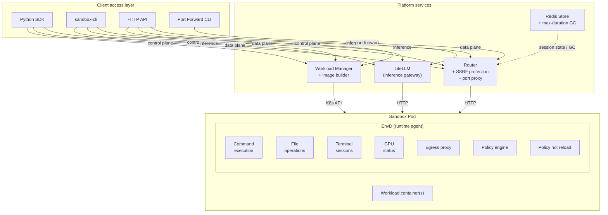

# Agent Sandbox Architecture

End-to-end view of how clients reach a sandbox and what runs inside the Pod.

## Components

| Component | Role |
| --- | --- |
| **Python SDK / sandbox-cli / HTTP API** | Client entry points for the management and sandbox APIs. |
| **Port Forward CLI** | Forwards a local port to a sandbox port through the Router's port proxy. |
| **Workload Manager** | Control plane: template/sandbox lifecycle on the K8s API, plus on-demand image building. |
| **Router** | Unified API gateway: routes data-plane invocations to the target Pod, with SSRF protection and port proxying. |
| **LiteLLM** | Inference gateway for OpenAI-compatible model calls from inside sandboxes. |
| **Redis Store** | Session/state store, with a background GC that deletes sandboxes past their `maxSessionDuration`. Nothing reclaims a sandbox for being idle. |
| **EnvD** | In-Pod runtime agent (port `8080`) exposing command execution, file operations, terminal sessions and GPU status, plus an egress proxy with a policy engine and hot policy reload. |
| **Workload container(s)** | The user's base image / sidecars running alongside EnvD. |

## Request planes

- **Control plane** — template and sandbox lifecycle, served by the Workload Manager.
- **Data plane** — code execution, files, sessions, terminal and GPU, served by EnvD and fronted by the Router.
- **Inference** — model calls routed through LiteLLM.
- **Port forward** — direct access to a sandbox port via the Router's port proxy.

See [API.md](./API.md) for the concrete HTTP routes.

## Eviction

A sandbox is a single-replica stateful workload: evicting its Pod ends the
session in it. So the Sandbox controller keeps a PodDisruptionBudget for every
Sandbox, the guard Kubernetes gives such a workload. It has the Sandbox's name,
the Sandbox owns it as it owns the Pod and the headless Service, and it selects
the Pod by its `agents.x-k8s.io/sandbox-name-hash` label with `minAvailable: 1`
and `unhealthyPodEvictionPolicy: AlwaysAllow`. An Eviction API call for a Ready
sandbox Pod (`kubectl drain`, a descheduler, any voluntary-disruption tool) is
answered `429 Too Many Requests`, and the session keeps running.

- Deleting the Pod or its Sandbox, a Sandbox's `shutdownTime`, and losing the
  node all delete the Pod directly and are not affected. The budget goes with
  its Sandbox through garbage collection, and with the Pod and Service when the
  Sandbox expires.
- A Pod that is Pending, has finished, or is Running but not Ready can still be
  evicted, so a broken sandbox never holds up a node drain.
- `kubectl drain` of a node that runs a Ready sandbox waits until the sandbox
  ends. To drain sooner, delete the sandbox first, or pass `--disable-eviction`
  so the drain deletes Pods instead of evicting them.
- Preemption by kube-scheduler is not an eviction: it prefers victims whose
  budgets allow a disruption, and can still preempt a lower-priority sandbox.
- A budget edited away from that spec is restored. One with the Sandbox's name
  that the Sandbox does not control is left alone: a reconcile error while the
  Sandbox runs, never adopted, and never deleted when it expires.
- The selector is the name hash the headless Service also selects by, so two
  Sandboxes of one namespace whose names hash alike share Pods there too; each
  Pod is then under two budgets, and the API server refuses its eviction with
  a 500 rather than a 429.

The control plane's ClusterRole grants `poddisruptionbudgets` in the `policy`
group (the chart and both plain manifests): the controller watches the budgets
it owns, and cannot sync its caches without that grant.
